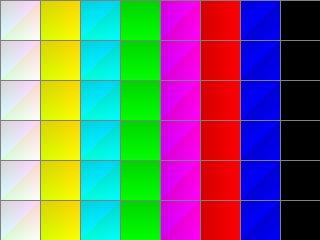

# GUI 与 LCD 输出管线：现在能到哪

> 状态：2026-11-20。结论基于当前 `b1330_131.bin` 静态字符串、QEMU 运行记录和
> D850-QEMU 机器现有功能；没有新的 boot ROM/flash dump。

## 1. 一句话

**当前动态执行的天花板仍是 `0x40028FF8`，之后是零页滑行；固件还没有执行到任何
显示初始化，也没有写过 framebuffer。** QEMU 里的 LCD 输出只是一个**主机侧
dump 工具**，可以用测试卡证明“guest RAM → PPM/PNG”这段通了，但它不是显示
控制器，也不能替代固件 GUI。

## 2. 当前执行到哪

| 实验 | 终点 | 显示相关 MMIO |
| --- | --- | --- |
| reset `0x1037CBA8` | `pop` 回 PC=0 → halt | 0 |
| `--init` 无页表 | `0x1035D5D4` prefetch abort | 0 |
| `--init --e5-tables` | **0 异常**，`bx ip` → `0x40028FF8`，随后零页滑行 | 0 |

已观测的 MMIO 只有：

```text
0x400E8450/54/58    init 的 boot 参数/暂存
0x4007C2E0/4        init 写 0x10 / 1
0x2E0014EC          init 读改写 0x80000000
```

**没有一条是 LCD/HDMI/GPU/EGL 寄存器。** 显示初始化代码尚未被执行到。

## 3. 静态证据：显示/UI 代码确实在镜像里

`b1330` 里有 50,342 条可打印字符串。与显示相关的例子：

| 字符串 | 地址 | 含义（仅从名字判断） |
| --- | --- | --- |
| `PLL_LCD` / `PLL_LCDCFG0` / `PLL_LCD_RESET` | `0x1180BE50` 起 | LCD 时钟/PLL |
| `LCDCKINV_SEL` / `PLLLCDEXT_SEL` | `0x1180D840` 起 | LCD 时钟选择 |
| `PADLCD` | `0x1180F2B0` | LCD pad/引脚 |
| `TFTBACK` / `@TFTSERV` / `TFTVD` | `0x1000EA78` 起 | TFT/显示服务 |
| `eglGetDisplay` / `eglQueryDisplayDMP` | `0x11809A88` 起 | EGL/DMP 图形栈 |
| `APPMENU` | `0x1025367B` | 应用菜单 |
| `ID_SW1_MENU` | `0x10450004` | 按键/菜单 ID |
| `PLL_HDMI*` / `HDMI_*` / `GPU_CLK_*` | `0x1180C2E0` 起 | HDMI/GPU 时钟 |

结论：**镜像内确实有显示、EGL/DMP、HDMI、TFT、菜单相关代码或符号**。但字符串
只证明“存在”，不证明当前执行路径能到达；这些字符串也没有被简单的绝对地址
xref 直接引用（更像符号/时钟表），所以还不能从字符串直接反推寄存器基址。

### 3.1 地址速查（按 `payload-base=0x10000000`）

| 项 | 地址 | 类型/置信度 |
| --- | --- | --- |
| `TFTBACK` 候选函数 | **`0x1000EA56`** | Thumb code，中：紧邻 `TFTBACK`；读 `0x0840ABB8+4` 的半字表，乘/移位/钳到 0xFF，像背光/亮度曲线 |
| `TFTSERV` 候选 dispatcher | **`0x1000EDDA`** | Thumb code，中低：紧邻 `@TFTSERV`；按命令 `0..0x66` 分支并调用 `0x10035678` |
| `APPMENU` 候选 handler | **`0x1025368C`** | Thumb code，低中：紧邻 `@APPMENU`；比较 r0=5/6，调用 `0x10235AE4` |
| `PLL_LCD`/`PLL_LCDCFG0`/`PLL_LCD_RESET` 表 | `0x1180BE40` 起 | data/clock table，高 |
| `PLL_HDMI*`/`HDMI_*`/`GPU_CLK_*` 表 | `0x1180C2E0` 起 | data/clock table，高 |
| `eglGetDisplay`/`eglQueryDisplayDMP` 符号串 | `0x11809A88` 起 | data/string，高；代码未定位 |
| `CMoviePlayApplicationService_ChangeDisplayConfiguration` | `0x1043B850` 起 | data/string，高 |
| `ID_SW1_MENU` 菜单 ID 表 | `0x10450004` 起 | data，高 |
| 显示 MMIO 寄存器基址 | **未确认** | — |
| framebuffer 基址/格式 | **未确认** | — |

文件偏移 = 地址 − `0x10000000`（例如 `0x1000EA56` → file `0xEA56`）。
这些是**镜像虚拟地址**；如果 `payload-base` 改了，整体加同一个偏移。

`TFTBACK`/`TFTSERV`/`APPMENU` 三个函数入口是**候选**，不是符号表确认的：镜像里
没有 ELF/符号表，ARM/Thumb 混排，绝对地址 xref 为 0。当前只能根据“字符串紧邻
+ 代码形态”给出入口；下一步要用 Ghidra/动态断点确认调用关系。

## 4. D780 的显示块不能直接套到 D850

D780-QEMU 的候选块是：

- `0x24040000`（display，256 KiB）
- `0x20180000`（graphics，64 KiB）
- `0xCC200000`（surface，4 MiB）

在 `b1330` 里搜索这三个地址：**0 次命中**。所以 D850 的显示/GPU 地址布局与
D780/E6 不同，不能把 D780 的寄存器桩直接搬过来。D850 的显示块需要从自己的
代码/运行记录里找。

## 5. LCD 输出管线是什么

D850-QEMU 机器继承了 D750-QEMU 的 `lcd-base/width/height/stride/format/out`
选项。它的实现是：

1. 从 `machine->ram` 取一段窗口；
2. 按 `rgb565`/`rgb888`/`argb8888` 转成 RGB；
3. 写一个 PPM 文件（每 2 秒或 halt 时）。

它**不模拟**：

- 显示控制器/DSI/HDMI；
- VSYNC/扫描时序；
- GPU/EGL/DMP；
- 面板背光/亮度/Gamma；
- 输入事件。

所以它是“看 guest RAM 里有没有图”的**诊断工具**，不是“让固件显示”的显示模型。

## 6. 测试卡实测：管线通，但不是固件画面

用主机写入一张 320×240 ARGB 测试卡到 `0x90000000`，再用 `lcd-base=0x90000000`
dump：

```sh
qemu-system-arm \
  -M nikon-d850,payload-base=0x10000000,entry=0x1037cba8,\
flash-size=0x2000000,lcd-base=0x90000000,lcd-width=320,lcd-height=240,\
lcd-stride=1280,lcd-format=argb8888,lcd-out=lcd-testcard.ppm \
  -device loader,file=lcd-testcard.bin,addr=0x90000000 \
  -cpu cortex-a15 -m 128M -display none -monitor none -serial null \
  -kernel b1330_131.bin -no-reboot -nic none
```

结果：

```text
d850-lcd: dumped 320x240 (argb8888, stride 1280) from 0x90000000 to .../lcd-testcard.ppm
```



**这张图是主机写入的测试卡，不是固件 UI。** 它证明“guest RAM → 扫描 → PNG”
这段是通的；真实固件目前不写帧缓冲，所以默认运行得到的是黑图。

## 7. GUI 还缺什么

要看到固件自己渲染的菜单/GUI，至少需要：

1. **stage-2 代码**：`0x40028FF8` 现在是零；没有它就没有后续 RTOS/应用；
2. **boot ROM/loader**：真实页表、段拷贝、异常 handler、reset 上下文；
3. **显示驱动初始化**：LCD PLL、TFT、DSI/HDMI、面板参数；
4. **GPU/EGL/DMP**：帧缓冲/command buffer/surface 的地址与格式；
5. **输入事件**：按键/MENU 事件、伴生 MCU/UART；
6. **调度器/应用**：菜单任务被拉起，才能谈 GUI。

当前这 6 项一项都还没有在 QEMU 里跑通。**所以“现有信息”能推到
`0x40028FF8`，但不能推出 GUI；LCD 只能推出主机侧测试卡。**

## 8. 还能做什么（不需要新 dump）

- **静态 xref**：从 `TFTBACK`/`PLL_LCD`/`eglGetDisplay` 附近的表结构反推
  display/clock 基址（目前绝对地址 xref 为 0，需要相对/表指针分析）；
- **跑 host-assisted 显示入口**：如果能定位 display init 函数，可以试着直接跳入，
  但没有 RTOS/堆/时钟状态，大概率在第一条 MMIO 或空指针处停；
- **补 `run.py --lcd-*`**：把测试卡路径做成可复现实验，作为管线回归；
- **记录**：任何真实固件写 framebuffer 的迹象（地址、stride、格式）都要先观测
  再建模，不猜。

## 9. 有了 boot ROM/flash 后

- 先按 [bootrom.md](bootrom.md) 拿 `0x40000000` 窗或 mask ROM；
- 若 stage-2 跑起来，观察第一条 display/GPU MMIO，再建寄存器桩；
- 等固件真正写 surface，再用 `lcd-base` dump 真实画面；
- 如果只有 boot ROM、没有显示/输入模型，仍可能停在显示初始化之前。

## 10. 边界

- 本文的“显示代码存在”只基于字符串；没有反汇编到具体函数，也没有执行证据。
- D780 的显示块不适用于 D850（0 次地址命中）。
- LCD dump 是主机侧工具，不是显示控制器；测试卡不代表固件 GUI。
- 不提供从固件提取的 UI 素材、字体、图标或截图。

---

### English summary

The current dynamic ceiling is still `0x40028FF8`; the next fetch runs into zero
pages. No display/GPU MMIO has been observed, and the firmware has not written a
framebuffer. The `b1330` image does contain display/EGL/DMP/HDMI/TFT/menu strings,
so the code exists, but it is not reachable yet. D780's candidate display blocks
(`0x24040000`, `0x20180000`, `0xCC200000`) have zero hits in `b1330`, so they do
not transfer.

The machine's LCD path is a host-side RAM-to-PPM dump, not a display model. A
host-written 320×240 test card proves the dump path works, but a firmware run is
black because nothing writes pixels. Reaching the firmware GUI needs stage-2 code,
boot ROM/loader, display/GPU/EGL models, a known framebuffer base/format, input
events, and a running scheduler—none of which are available yet.
