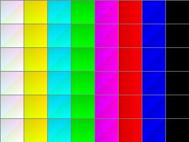

# LCD 测试卡：主机侧管线验证（不是固件画面）

- 日期：2026-11-20
- 机器：`nikon-d850`（payload @ `0x10000000`，entry `0x1037CBA8`，CPU `cortex-a15`）
- 固件：`b1330_131.bin`（SHA-256 `97E1DA12…204003`）

## 命令

```sh
# 主机生成 320x240 ARGB 测试卡 -> 307,200 B
python make_lcd_card.py

qemu-system-arm \
  -M nikon-d850,payload-base=0x10000000,entry=0x1037cba8,\
flash-size=0x2000000,lcd-base=0x90000000,lcd-width=320,lcd-height=240,\
lcd-stride=1280,lcd-format=argb8888,lcd-out=lcd-testcard.ppm \
  -device loader,file=lcd-testcard.bin,addr=0x90000000 \
  -cpu cortex-a15 -m 128M -display none -monitor none -serial null \
  -D lcd-testcard.log -d guest_errors,int -no-reboot -nic none \
  -kernel b1330_131.bin
```

## 结果

```text
exit=0  ppm=230415
d850-lcd: dumped 320x240 (argb8888, stride 1280) from 0x90000000 to .../lcd-testcard.ppm
```



## 解读

这张图是**主机写入** `0x90000000` 的测试卡，不是 D850 固件渲染的 UI。它证明：

- `lcd-base/width/height/stride/format/out` 选项能从 guest RAM 取窗口并写出 PPM；
- `argb8888` 的字节序（内存 B,G,R,A）和 stride 处理正确；
- 同一路径可以用于未来真实 framebuffer 的 dump。

它**不**证明：

- 固件执行到了显示初始化；
- 显示控制器/DSI/HDMI/GPU/EGL 被建模；
- 固件写过 framebuffer。

当前固件运行没有观测到任何 LCD/GPU/HDMI MMIO，`0x40028FF8` 之后仍是零页滑行；
所以真实固件画面仍是黑图。
